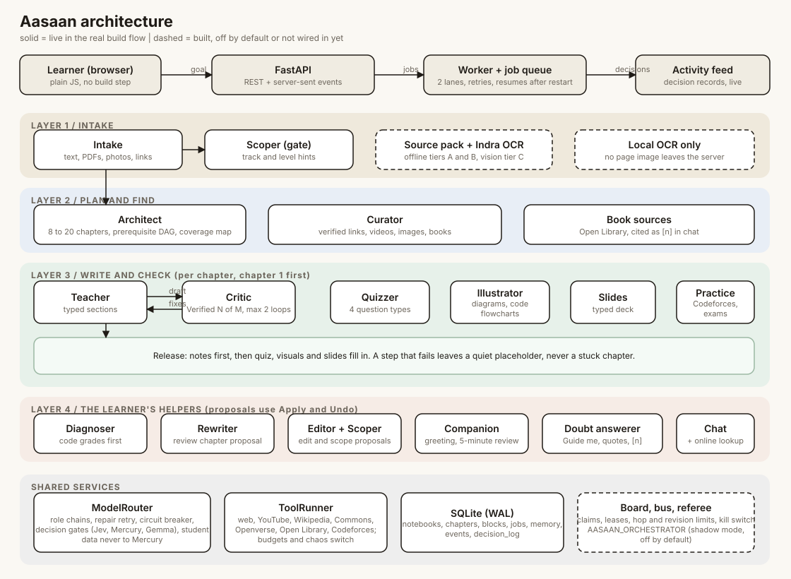

  

<h1 align="center">Aasaan</h1>

<b>Learning made aasaan.</b> (ஆசான், Tamil for "teacher"; in Hindi, "aasaan" means "easy".)

Type a goal ("I want to learn DSA"), or paste notes, links, photos and PDFs into one chat box. Aasaan builds a **notebook**:
a complete course with chapters, notes, verified links, videos, images with attribution, slide cards and quizzes.
The notebook has two views of the same course: a **roadmap** and a **prerequisite graph**. A small swarm of specialised
agents does the work; the student only sees a clean notebook.

To run it locally, see **[HOW_TO_RUN.md](HOW_TO_RUN.md)**.

> 🌐 **Live Prototype**: [https://aasaan.purplemoss-02047b9c.centralindia.azurecontainerapps.io/](https://aasaan.purplemoss-02047b9c.centralindia.azurecontainerapps.io/)
>
> Deployed on Microsoft Azure Container Apps (Central India). This prototype is active and stays online until Azure cloud credits are maxed out. See [AZURE_DEPLOYMENT_README.md](AZURE_DEPLOYMENT_README.md) for architecture and CI/CD details.

## How it works

- **Layer 1, Intake:** reads what the learner gives (text, PDFs, photos, links) and turns it into clean, referenced chunks.
- **Layer 2, Plan and find:** the Architect plans 8 to 20 chapters with prerequisites (a graph checked in code, mapped against the learner's own contents list). The Curator finds and verifies links, videos, images and books.
- **Layer 3, Write and check:** per chapter, the Teacher writes typed notes, the Critic checks them against the sources (up to 2 fix rounds, shown as "Verified N of M claims"), and the Quizzer, Illustrator, Slides and Practice agents fill in the rest. Chapter 1 is built first so the notebook opens quickly.
- **Layer 4, Learner helpers:** wrong answers are graded in code and the misconception is named. Anything that changes the course (review chapters, scope, edits) is a **proposal** with Apply and Undo. The chat answers from the notebook, quotes its source, cites `[n]`, and can look things up online when the notebook cannot answer.
- **Shared services:** a model router with fallback chains (`config/models.yaml`), a tool runner for the web (budgets, rate limits, a chaos switch), and SQLite. A live **Activity** tab shows what each agent decided.

Honest status: the build is a fixed pipeline with one real feedback loop (Critic to Teacher). The board, message bus and referee exist and can mirror a build (`AASAAN_ORCHESTRATOR`), but they are off by default. The Indra OCR intake is built and tested but not yet wired into the live flow.

## What we build on

Aasaan is plain Python and plain JavaScript on a small set of open-source parts. Licences are as published by each project; check them before commercial use.

| Part | Used for | Licence |
|---|---|---|
| [FastAPI](https://github.com/fastapi/fastapi), [Starlette](https://github.com/encode/starlette), [Uvicorn](https://github.com/encode/uvicorn) | API and live updates (server-sent events) | MIT, BSD |
| [Pydantic](https://github.com/pydantic/pydantic) | typed, validated agent outputs | MIT |
| [HTTPX](https://github.com/encode/httpx) | all outgoing HTTP | BSD |
| [SQLite](https://sqlite.org) | the only database (WAL mode) | public domain |
| [PyYAML](https://github.com/yaml/pyyaml) | model chains and agent manifests | MIT |
| [pypdf](https://github.com/py-pdf/pypdf), [pypdfium2](https://github.com/pypdfium2-team/pypdfium2) | reading and rendering PDF pages | BSD, Apache-2.0 |
| [Pillow](https://github.com/python-pillow/Pillow) | thumbnails, test fixtures | HPND |
| [trafilatura](https://github.com/adbar/trafilatura) | clean text from web pages | Apache-2.0 |
| [Indra OCR](https://github.com/datalab-to/indra) (optional, in Docker) | fast offline OCR for scans | code Apache-2.0; model weights under a modified OpenRAIL-M licence |
| [Gemma 4](https://ai.google.dev/gemma) | the main writing, checking and vision models (open weights) | Gemma terms of use |
| [pytest](https://github.com/pytest-dev/pytest) | the test suite | MIT |
| [Caddy](https://github.com/caddyserver/caddy), [Docker](https://www.docker.com) | HTTPS and deployment | Apache-2.0 |
| [Newsreader](https://github.com/productiontype/Newsreader), [Hanken Grotesk](https://github.com/marcologous/hanken-grotesk) | fonts | SIL OFL |

The frontend has no framework and no build step (`frontend/`).

**Open data and free APIs:** [Wikipedia](https://www.wikipedia.org), [Wikimedia Commons](https://commons.wikimedia.org), [Openverse](https://openverse.org) (images keep their licence and author), [Open Library](https://openlibrary.org) (books), the [Codeforces API](https://codeforces.com/apiHelp) (practice problems, linked out; statements are never copied).

**Hosted services (not open source; only one model key is required):** Google AI Studio for Gemma, OpenRouter, Sarvam AI (Indian languages, speech), Jev and Mercury Decide (small decision models), YouTube Data API, Jina Reader, Firecrawl.

## Privacy and limits

No accounts. A random learner id lives in the browser; memory (mistake labels, progress) and uploads stay in the local database and data volume. Student text is never sent to the free decision model, and an optional `Local OCR only` mode keeps page images on the server. No medical, legal or other sensitive advice. Notes are written in the tutor's own words: third-party pages are used to check facts and to link to, never pasted.

## More

- [HOW_TO_RUN.md](HOW_TO_RUN.md): install, configure, run, test, Docker
- [DEPLOY.md](DEPLOY.md): one small server with HTTPS, backups and Azure Container Apps notes
- [AZURE_DEPLOYMENT_README.md](AZURE_DEPLOYMENT_README.md): Azure Container Apps architecture, SQLite EmptyDir pattern, and GitHub CI/CD deployment guide
- [build-log/](build-log/): what was built, milestone by milestone, and the Milestone 4 checklist
- [eval/](eval/): quality baseline and the Indra OCR spike report
- `PRD.md`, `agents/`, `architecture/`: the original planning documents, kept for reference
